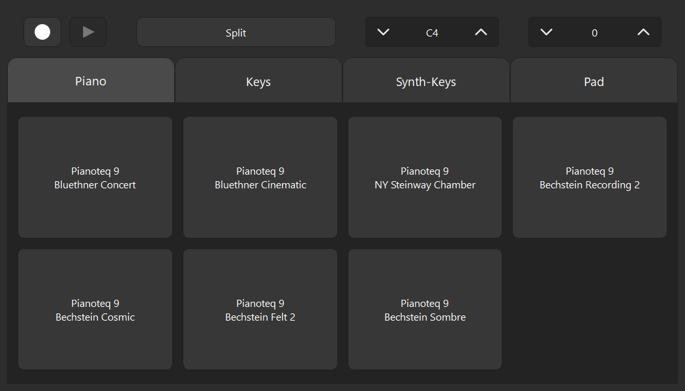

## Preface

I made this application on a weekend back in 2021 to transform an old Casio keyboard with dated, unimpressive sounds (but a decent keybed) into something relevant and high quality. By simply grabbing an old hp elitedesk mini and buying a $35 5 inch touchscreen, this Casio can now play Pianoteq, Arturia Pigments, etc. in a single press of the finger.

I wanted to make this code public but I knew it needed work to be simple to implement. I could never get to creating instructions for Carla setup, scripts for setting up audio/JACK, real time audio Linux optimizations (passing rtqcs), etc. Which I did manually at the time.

Now that I've decided to update this application with new features (like Midi Record/Playback), I hope to get to the setup scripts as well. 

# Carla Interface

Touchscreen PyQt6 front-end for a fixed [Carla](https://kx.studio/Applications:Carla) rack: preset buttons, keyboard split, octave shift, and more. It talks to Carla over OSC (`oscsend`) and sends MIDI program changes through ALSA (`aplaymidi`).



Python **3.10**, Linux. The piano-PC overlay (autostart, JACK, Carla project) lives in [`os/`](os/) and is not required to edit the app.

The Carla example in this repo is specific to my setup, but does well to show how many types of programs can interact with this interface. (For example, Pianoteq takes program changes, Pigments does not and takes midi commands).

## Setup

System package (Linux):

```bash
sudo apt install liblo-tools alsa-utils   # oscsend, aplaymidi, arecordmidi
```

App venv (from `app/`):

```bash
python3.10 -m venv .venv
source .venv/bin/activate
pip install -r requirements.txt
python main.py
```

Edit [`app/main.py`](app/main.py) to change patches, categories, and Carla rack indexes. That should be the only code a user needs to touch. Everything else lives under `app/carla_interface/`.

## Runtime notes

- OSC: `oscsend` to `localhost:22752` (Carla’s OSC port).
- MIDI: `aplaymidi` to ALSA `Midi Through Port-0` (bridged into Carla by a2jmidid). Pigments program changes use MIDI channels 2 (main) and 3 (split); channel 1 is the keyboard.
- `app/assets/sendosc.exe` is an unused Windows leftover; the app is Linux-only.
- XFCE autostart runs [`os/home/startup_scripts/audio/carlaInterface.sh`](os/home/startup_scripts/audio/carlaInterface.sh), which starts `~/CarlaInterface/main.py` with `~/CarlaInterface/venv`. [`deploy.ps1`](deploy.ps1) copies `app/` to that path and `os/home/` onto the user home.
